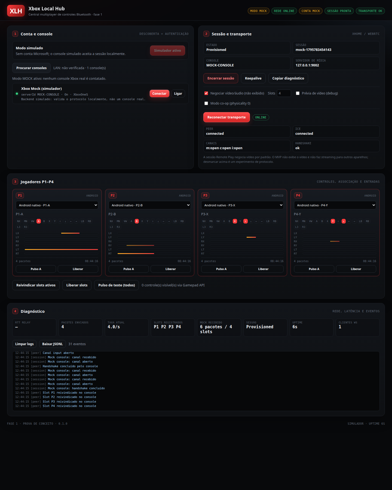
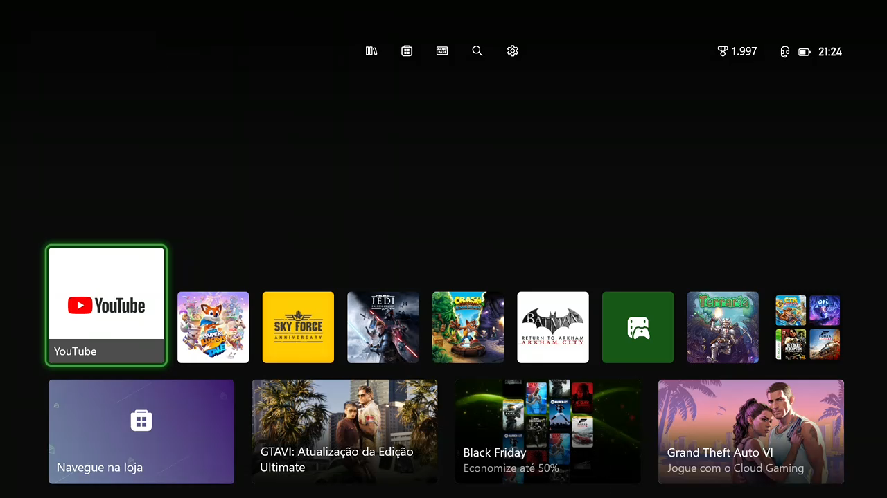
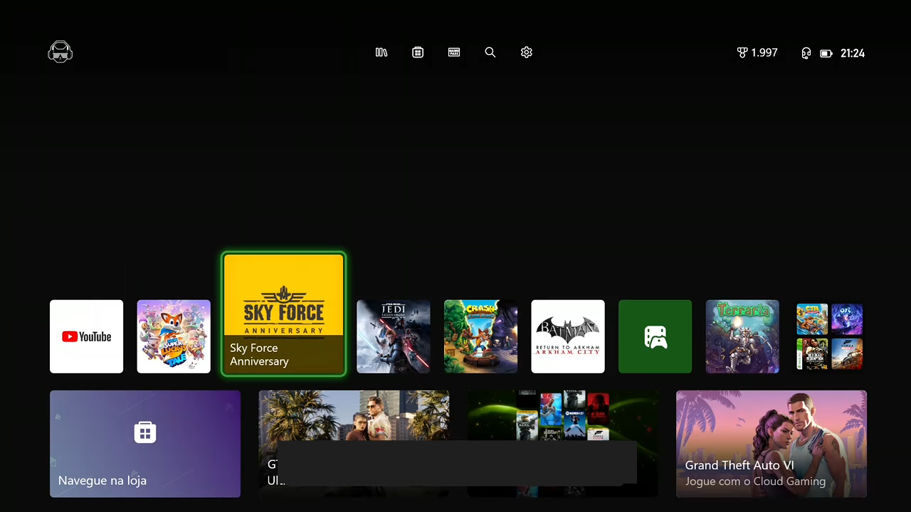

# Xbox Local Hub

**Central multiplayer de controles Bluetooth para Xbox Remote Play — fase 1 (MVP).**

O projeto transforma um Android em central de captura de até quatro controles Bluetooth e encaminha cada jogador como uma identidade separada para um Xbox One S, usando o protocolo de Remote Play já validado por clientes open-source. A imagem continua na TV; o MVP **não** faz streaming de tela para o celular.

> **Status (27/11/2026):** a pilha foi validada em um **Xbox One S real**: autenticação, descoberta, sessão xHome, WebRTC, handshake e **entrada remota funcional** (o foco do dashboard saiu de YouTube para Sky Force e um jogo foi aberto). Quatro índices de gamepad foram registrados e aceitos. A separação de **quatro identidades de jogador** em um jogo local ainda está em investigação — veja [docs/MVP_RESULTS.md](docs/MVP_RESULTS.md).



Prova em hardware real: foco em YouTube → Sky Force, causado por dois D-Pad Right enviados pelo celular.

| Antes | Depois |
|---|---|
|  |  |

## O que está pronto

| Componente | Estado |
|---|---|
| Descoberta SmartGlass na LAN (UDP 5050) | implementada + testes de codec |
| Login Microsoft por device code | validado em hardware real |
| Lista de consoles Xbox Live (`serverId`) | validado em hardware real (id omitido) |
| Sessão xHome (`/v5/sessions/home/*`) | validada: `Provisioned` → SDP/ICE → WebRTC |
| Despertar console (`Power/WakeUp` via xccs) | validado (ConnectedStandby → On) |
| Handshake WebRTC, canais `message`/`control`/`input` | validado no Moto G200 contra o Xbox real |
| Codificador binário de entrada (até 4 índices) | validado com 4 slots registrados no console |
| Entrada remota real | **validada**: D-Pad moveu o foco; A abriu e iniciou jogos |
| Dashboard de operação e diagnóstico | implementado, responsivo (funciona no celular) |
| Relay HTTP/WebSocket + logs JSONL + token de acesso | implementado + testes |
| App Android (React Native + Kotlin: `InputDevice`, P1–P4) | **compilado, instalado e executado no Moto G200** |
| Quatro identidades de jogador independentes | **em investigação** — 4 índices aceitos; co-op local ainda não comprovado |

## Arquitetura em uma tela

```text
┌──────────────────────────────┐        ┌──────────────────────────────┐
│ Android (RN + Kotlin)        │        │ Dashboard web (Chrome)       │
│ • InputDevice/KeyEvent       │        │ • WebRTC (data channels)     │
│ • P1..P4, normalização       │        │ • Gamepad API / bridge nativo│
│ • WebView transport          │        │ • UI e diagnóstico           │
└──────────────┬───────────────┘        └──────────────┬───────────────┘
               │ frames nativos (JSON)                 │ SDP/ICE REST
               ▼                                       ▼
        ┌────────────────────────────────────────────────────┐
        │ Relay Node/TypeScript (PC, notebook ou Termux)     │
        │ • auth Microsoft (xal-node)                        │
        │ • descoberta LAN + lista Xbox Live                 │
        │ • sessão xHome, SDP/ICE, keepalive                 │
        │ • API/WS, logs, P1–P4 persistidos                  │
        └──────────────────────────┬─────────────────────────┘
                                   │ Wi-Fi/LAN
                                   ▼
                            Xbox One S (Remote Play)
```

O WebRTC fica no navegador/WebView (stack madura, H.264, ICE, DTLS/SCTP). O relay cuida de autenticação e do protocolo REST do console. O Android captura os controles com `InputDevice` e injeta os estados no WebView. Essa divisão evita reimplementar WebRTC em Kotlin na fase 1 e mantém a captura de baixa latência no lado nativo.

## Requisitos

- Node.js **20.11+** (testado em Node 24).
- Xbox One S com **Remote Play habilitado** e na mesma rede local.
- Conta Microsoft com perfil Xbox.
- Navegador Chromium/Chrome atualizado (para o transporte WebRTC).
- Opcional: Android com JDK 17 + Android SDK 35 para compilar o app.

## Início rápido — modo simulado (sem Xbox)

```bash
npm install
npm run mock
```

Abra `http://127.0.0.1:8787/`. O modo mock:

1. mostra um console falso;
2. aceita a sessão localmente;
3. responde ao SDP com um peer WebRTC `werift`;
4. decodifica os pacotes binários reais e exibe os quatro slots no diagnóstico.

Clique em **Conectar**, aguarde o handshake e use **Pulso de teste (todos)** ou abra o dashboard em um navegador com controles conectados. Isso valida a UI, o handshake, o encoder e a independência dos quatro índices — **não** prova compatibilidade com o Xbox.

## Uso com o Xbox real

```bash
npm run build
npm start -- --host=0.0.0.0
```

O `--host=0.0.0.0` expõe o dashboard na rede local e gera um token de acesso em `~/.config/xbox-local-hub/access-token`. A URL impressa no terminal já contém o token.

1. **Entrar com Microsoft** → abra `microsoft.com/link`, informe o código e aguarde.
2. **Procurar consoles** → a lista combina a descoberta LAN (IP/nome) com a lista Xbox Live (`serverId`, obrigatório para a sessão).
3. **Conectar** → o relay abre a sessão xHome, negocia SDP/ICE e o navegador estabelece o WebRTC.
4. Conecte os controles ao aparelho que está rodando o dashboard. No Android, o app nativo injeta os quatro controles no WebView.
5. **Reivindicar slots ativos** registra P1–P4 no console (`gamepadChanged`).
6. Confira no diagnóstico: handshake, pacotes/s, slots registrados e eventos.

### Controles no navegador

Chrome/Edge expõem controles Bluetooth via Gamepad API. O dashboard associa automaticamente os primeiros controles aos slots livres e permite remapear. Em alguns Androids a Gamepad API é limitada; por isso o app nativo é o caminho recomendado para quatro controles.

### Onde ficam os dados

```text
~/.config/xbox-local-hub/
├── auth.json        # refresh token Microsoft (0600)
├── access-token     # token do relay (0600, quando host != loopback)
├── players.json     # associação P1..P4
└── logs/relay.jsonl # log estruturado
```

## App Android

O código está em [`apps/android/`](apps/android/). Ele contém:

- `bluetooth/ControllerDiscovery.kt` — enumeração e monitoramento de `InputDevice` com source `JOYSTICK`/`GAMEPAD`;
- `input/GamepadMapper.kt` + `input/ControllerHub.kt` — botões, analógicos, gatilhos, deadzone e frames JSON a 60 Hz;
- `multiplayer/PlayerManager.kt` — P1–P4 persistidos em `SharedPreferences`;
- `XboxLocalHubTransportView.kt` — WebView nativo que carrega o dashboard e recebe os frames sem passar pela bridge do RN;
- `XboxLocalHubControllerModule.kt` — APIs e eventos para as telas React Native;
- `src/` — telas TypeScript (Status, Controles, Diagnóstico).

O `README` do app tem os passos de build. O APK debug foi gerado com JDK 17 + Android SDK 35 e instalado via ADB. Para repetir:

```bash
export JAVA_HOME=/caminho/jdk-17
export ANDROID_HOME=/caminho/android-sdk
cd apps/android
npm install
npx react-native start --port 8081
cd android && gradle assembleDebug
adb install -r app/build/outputs/apk/debug/app-debug.apk
adb reverse tcp:8081 tcp:8081
adb reverse tcp:8787 tcp:8787
```

## Comandos

```bash
npm run dev            # dashboard + relay com reload
npm run mock           # simulador local
npm test               # 39 testes unitários/integração
npm run test:e2e       # e2e com Chrome real + console simulado
npm run auth           # login por device code no terminal
npm run discover       # descoberta SmartGlass
npm run consoles       # lista consoles do Xbox Live
npm run doctor         # diagnóstico do ambiente
npm run typecheck
```

## Limitações honestas da fase 1

- **Quatro identidades no console ainda não foram comprovadas.** O protocolo tem índice de gamepad (0–3) e o cliente open-source Greenlight declara quatro slots; o XStreaming expõe apenas dois no modo co-op. Se o servidor do console aceitar apenas dois, isso será descoberto no teste de hardware.
- **Vídeo é negociado por padrão.** O Remote Play aponta o console para um sink WebRTC; o MVP não exibe o vídeo. Desmarcar “negociar vídeo/áudio” é um experimento e pode ser rejeitado pelo console.
- **Foco em LAN.** Não há expansão Teredo/port forwarding para Remote Play fora de casa.
- **Auth usa o client id público do xal-node** (o mesmo do Greenlight). Não há app registration próprio.
- **Coexistência com controles locais do Xbox** é teoricamente possível (o console aceita controles físicos e entradas remotas), mas precisa ser comprovada.
- **Captura de controles Bluetooth físicos** ainda não foi exercitada; o bridge nativo foi validado com entradas sintéticas.
- **Vídeo/áudio não são renderizados** e não há gravação.

## Evidências da execução real

- [App no Moto G200](docs/evidence/app-android-status.png)
- [Dashboard no celular com sessão real](docs/evidence/phone-real-session.png)
- [YouTube focado](docs/evidence/xbox-real-home-youtube-focus.png) → [Sky Force focado após D-Pad](docs/evidence/xbox-real-home-skyforce-focus.png)
- [Detalhes do Jedi abertos com A](docs/evidence/xbox-real-jedi-details.png)
- [Jogo iniciado pelo comando remoto](docs/evidence/xbox-real-game-launched.png)
- [Prompt P1 no Sky Force](docs/evidence/xbox-real-p1-prompt.png)
- [Tentativa de co-op com P2](docs/evidence/xbox-real-coop-p2-attempt.png)

## Documentação

- [docs/ARCHITECTURE.md](docs/ARCHITECTURE.md) — componentes, fluxo e decisões.
- [docs/XBOX_PROTOCOL.md](docs/XBOX_PROTOCOL.md) — protocolo pesquisado, com fontes e tabelas de bytes.
- [docs/MULTIPLAYER.md](docs/MULTIPLAYER.md) — hipótese, evidências e matriz de teste P1–P4.
- [docs/TESTING.md](docs/TESTING.md) — testes automatizados e roteiro de hardware.
- [docs/MVP_RESULTS.md](docs/MVP_RESULTS.md) — o que foi executado, o que falta e conclusão.
- [AGENTS.md](AGENTS.md) — guia para agentes/contribuidores.

## Aviso

Projeto independente, sem afiliação com Microsoft ou Xbox. “Xbox” e “Remote Play” pertencem à Microsoft. Use apenas com sua própria conta e console.
